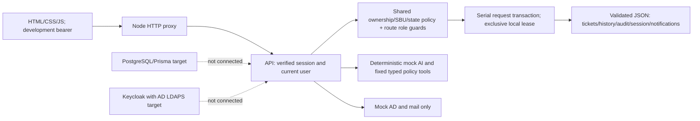

> Day 6 adds authenticated ingress and shared PostgreSQL admission. PostgreSQL now handles scoped ticket pagination and analytics aggregation. JSON remains the default. [Day 6 acceptance](development-reports/DAY6_SECURITY_PERFORMANCE_2026-11-11/13_FINAL_ACCEPTANCE.md)

> Day 4 local update (implemented 2026-11-10 for the 2026-11-11 milestone): optional enterprise Code+PKCE authentication now uses validated discovery/JWKS and opaque sessions; controlled-issuer HTTP/browser tests pass. Real Keycloak/AD and hosted acceptance remain pending. JSON stays the default store. See [authentication contract](security/ENTERPRISE_AUTHENTICATION.md) and [Day 4 report](development-reports/DAY4_DEVELOPMENT_REPORT_2026-11-11.md). Older implementation statements below are historical.

> Day 3 update (2026-11-10): A tested isolated PostgreSQL repository/outbox slice now exists; the application still runs on JSON. See [repository contract](architecture/POSTGRES_REPOSITORY.md) and [Day 3 acceptance](development-reports/DAY3_ACCEPTANCE_2026-11-10.md). Earlier statuses below are historical. Hosted checks, independent review, prerequisite integrations and production cutover remain gates.

# AIIT System Architecture

> Verified runtime correction (2026-11-08): The running frontend and API use Node HTTP and local JSON storage. Next.js, NestJS, PostgreSQL/Prisma and BullMQ entries below describe intended/scaffolded architecture. Live RS256/JWKS OIDC and Redis are not implemented. Development HMAC authentication is disabled in production; see IMPLEMENTATION_STATUS.md.
**Project:** Enterprise Multi-SBU AI-Powered IT Support System

## 1. High-Level Topology
The platform is organized as a modular TypeScript monorepo (`pnpm` workspaces) avoiding premature microservice complexity while maintaining clean domain boundaries:

```
Cutomer_IT_Support_System/
├── apps/
│   ├── web/          # Enterprise Portal UI (Next.js App Router + Accessible Web Server & API Proxy)
│   ├── api/          # Modular REST API, RBAC Guard, State Machine, OpenAPI 3.1, Prisma Schema
│   └── worker/       # Background Notification & SLA Queue Processor (BullMQ / Resilient Local Queue)
├── packages/
│   ├── shared/       # Domain Models, RBAC Policies, Ticket State Machine, Schema Validators, Redactor
│   └── connectors/   # AD Adapter, Self-Hosted Mail & Mailbox Provisioning Adapters, AI Policy Engine
├── infra/            # Docker Compose (PostgreSQL 16, Redis 7, Keycloak 26, Mailpit) & Realm Blueprint
├── docs/             # Enterprise Architecture, Security, Integration & Operational Documentation
└── tests/            # Unit, Full-Stack Integration, and Playwright E2E Browser Suites
```

## 2. Data & Control Flow
1. **Authentication**: Users authenticate via Keycloak OIDC (`/realms/upstra-enterprise`) or the development OIDC identity provider (`POST /api/auth/login`), receiving a locally signed development JWT (`HS256`; production JWKS flow remains unimplemented) carrying `sub`, `role`, `sbuId`, and `sbuCode`.
2. **Ticket Submission & AI Triage (`POST /api/tickets`)**:
   - Input is validated by `validateCreateTicketInput`.
   - Ticket is persisted in `NEW` state, transitioned through `TRIAGED` to `AI_HANDLING`.
   - Untrusted ticket text is scrubbed of secrets/tokens via `redactSensitiveData`.
   - `DeterministicMockAIOrchestrator` evaluates the ticket against approved Knowledge Base articles and the `TYPED_TOOL_REGISTRY`.
   - **Low-risk eligible issues** (e.g., Outlook TLS setup, Wi-Fi/DNS check) transition to `RESOLVED_PENDING_CONFIRMATION` with step-by-step guidance.
   - **Privileged, uncertain, or high-severity issues** (e.g., AD group changes, mailbox provisioning, hardware outages) create an `Approval` record if required and route to `ASSIGNED_TO_IT`.
3. **IT Queue & CTO Escalation**:
   - IT Administrators work tickets in `ASSIGNED_TO_IT` / `IN_PROGRESS` and can escalate critical or unresolved tickets via `POST /api/tickets/:id/escalate-cto` to `ESCALATED_TO_CTO`.
   - The CTO reviews cross-SBU escalations and pending executive approvals.
4. **Resilience & Graceful Degradation**:
   - If the AI provider, Redis broker, or SMTP server is unreachable, ticket creation and state transitions still succeed transactionally; notifications remain safely `QUEUED` for retry.

## Day 2 authoritative runtime update (2026-11-09)

Earlier descriptions of live Keycloak, resilient retry and production transactional persistence remain target requirements. Implemented runtime:



Request body listeners attach before serial queueing; transaction loads current storage, captures business mutation/history/audit/notification intent, buffers response then atomically replaces the file before sending success. Storage failures discard state and return failure. Standalone JSON worker exits without storage access. All requests contend on the same local filesystem lease; no multi-host or high-availability claim. Restart reload and injected write-failure tests pass; crash/power-loss durability is not certified.

See architecture/PERSISTENCE_RECOVERY.md, architecture/DATABASE_DESIGN.md, architecture/AUTHENTICATION_AUTHORIZATION.md and security/ROLE_PERMISSION_MATRIX.md for implemented vs designed vs blocked boundaries. Integrations remain simulated; AD/mail privileged writes remain disabled. Existing Role.permissions is descriptive, not a universal permission evaluator. Real outbox/worker, scoped support memberships, CSRF/TLS/BFF, enterprise IdP and immutable audit remain release work.

## Final Day 2 foundation status

Native Node API/web and transaction-contained JSON remain the runtime. The database migration/importer is now implemented and tested against disposable PostgreSQL, with schema parity and populated UUID-to-TEXT preservation. It is not wired into API storage. A locked toolchain now runs actual tsc/ESLint, native tests and Chromium; browser session tokens are no longer persisted in localStorage. Origin checks protect cookie writes, explicit organizational grants remain unchanged, and high/critical triage always enters IT. Hosted CI has four separated jobs but cannot schedule until GitHub account billing/spending restriction is resolved. See final acceptance evidence for details.
