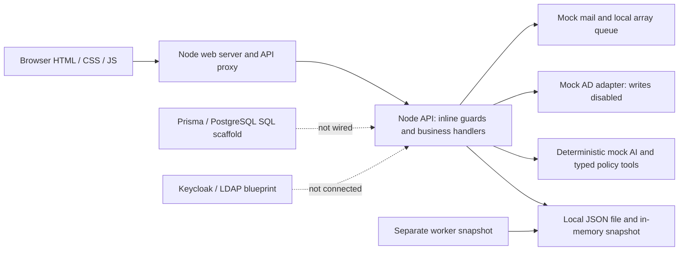

# AIIT — Week 1 Day 1 baseline audit

**Date:** Sunday, 8 November 2026 · **Timezone:** Asia/Dhaka  
**Mission:** repository audit, verification and implementation baseline.  
**Day 1 status:** **COMPLETE for the audit scope.** This is not completion of the enterprise platform or production readiness. Failed security expectations, missing tools and blocked operational verification are explicitly recorded below. No application repair was necessary to perform this audit.

## Executive summary

AIIT has a working local development application: the public site and workspace load; development users can view their scoped tickets, create support requests, receive deterministic mock guidance and use several existing ticket/approval/asset workflows. The existing 24 tests pass.

It is not an enterprise production system yet. Authentication is locally issued development tokens, storage is a JSON file, and AI/directory/mail are simulated. Live Keycloak, transactional PostgreSQL access, durable queues, CI and staging are not implemented/validated. Nine isolated audit expectations failed despite the green existing suite. The most urgent problems are concurrent data loss, closure of CTO escalations by requesters, mutable approval decisions, bearer tokens surviving logout and secret-like notes persisting in logs/notifications.

Today's work changed documentation and audit evidence only. The shared data hash and existing application/test/configuration hashes were checked for preservation. No seed/reset, dependency installation, migration, production deployment, real directory action or corporate email was performed. The 10 December 2026 readiness date remains a planning target, not a guarantee.

## Git baseline

- Working directory: `/Users/tawsifjawad/Documents/Work/Cutomer_IT_Support_System`.
- Branch: `main`, **unborn**. `git rev-parse --verify HEAD` exits 128; there is no initial commit.
- `git status --short --branch` begins `## No commits yet on main`; all project paths are untracked. `git ls-files` returns no tracked files.
- No release tags and no configured Git remote names were found.
- Local Git configuration names are standard repository metadata (`core.repositoryformatversion`, `filemode`, `bare`, `logallrefupdates`, `ignorecase`, `precomposeunicode`). Global settings were not rewritten or dumped.
- `.env` is ignored. Its variable names were inventoried without printing values; its bytes currently match the example template. No real credential was required or disclosed.
- No reset, clean, checkout, add, commit, tag, remote change or unrelated revert was performed.

Machine-readable initial state and file hashes: [initial-baseline.json](evidence/initial-baseline.json). Source-control baseline creation is future reviewed work, not an audit-side mutation.

## Repository structure

```text
Cutomer_IT_Support_System/
├── package.json / pnpm-workspace.yaml / tsconfig.json
├── .env.example / .gitignore                 # values omitted from this report
├── apps/
│   ├── web/
│   │   ├── src/server.ts                     # actual Node HTTP HTML/proxy runtime
│   │   ├── src/landing.ts
│   │   ├── public/{design.css,portal.js,public.js,*.svg}
│   │   └── app/page.tsx                      # unused Next.js page scaffold
│   ├── api/
│   │   ├── src/{main,app,auth,store,queue}.ts
│   │   ├── src/prisma/seed.ts                # destructive local reset; not run
│   │   └── prisma/{schema.prisma,migrations/20261108000000_init/migration.sql}
│   └── worker/src/main.ts                    # independent JSON snapshot processor
├── packages/
│   ├── shared/src/index.ts                   # domain, state machine, RBAC, validation, redaction
│   └── connectors/src/index.ts               # deterministic AI, mock AD/mail, typed registry
├── infra/
│   ├── docker-compose.yml                   # dependency services, not app images
│   └── keycloak/upstra-enterprise-realm.json
├── scripts/verify-types.ts                   # import/script syntax checks, not tsc
├── tests/{unit,integration,recovery,ui}.test.ts
├── tests/e2e/portal.spec.ts / playwright.config.ts
└── docs/
    ├── SRS.md / ARCHITECTURE.md / DECISIONS.md / SECURITY.md
    ├── AD_INTEGRATION.md / EMAIL_INTEGRATION.md / DEPLOYMENT.md
    ├── TEST_REPORT.md / UI_REDESIGN.md / screenshots/
    ├── IMPLEMENTATION_STATUS.md / REQUIREMENTS_TRACEABILITY.md
    ├── TECHNICAL_DEBT.md / MIGRATION_PLAN.md / ROADMAP.md
    └── audits/WEEK1_BASELINE.md / evidence/
```

Dependency directories, `.git` internals, live data, credential values, build output and caches are excluded. No independent IT task-list document, CI configuration, application Dockerfile, lockfile or staging configuration was found in this checkout.

## Technology inventory

The actual executing stack is TypeScript on Node's native runtime, Node `http`, plain HTML/CSS/canvas and browser JavaScript. There is no installed third-party application dependency tree in this checkout. Manifest declarations are not installed-version evidence.

| Component | Declared / template version | Actual evidence |
| --- | --- | --- |
| Node | engines >=20 | Executed v26.8.1; lower supported range not verified |
| npm | Not pinned | 11.19.0 installed |
| pnpm | packageManager pnpm@9.15.0 | 11.25.0 installed; mismatch |
| Git | Not pinned | 2.50.1 installed; no commit |
| TypeScript | 5.7.2 | Not installed; native execution is not type checking |
| Next / React / React DOM | 15.1.3 / 19.0.0 / 19.0.0 | Declared, not installed; unused page scaffold |
| Nest common/core, Swagger | 10.4.15 / 8.0.7 | Declared, not installed; actual API uses Node HTTP |
| Prisma / Prisma client | 6.1.0 | Declared, not installed; schema/SQL only |
| PostgreSQL | Compose 16-alpine | psql client 18.6 installed; no server/migration connection attempted |
| BullMQ / ioredis | 5.34.3 / 5.4.2 | Declared, not installed; local array queue instead |
| Redis | Compose 7.4-alpine | Template only; no Redis connection verified |
| openid-client | 6.1.7 | Declared, not installed; custom development HMAC auth instead |
| Keycloak | Compose 26.0 | Template only; live integration absent |
| nodemailer | 6.9.16 | Declared, not installed; mock/TCP-only Mailpit helper |
| Mailpit | Compose v1.21 | Template; SMTP delivery unverified/nonfunctional adapter semantics |
| zod | 3.24.1 | Declared, not installed; handwritten validation instead |
| Tailwind | 3.4.17 | Declared, not installed; active UI is centralized plain CSS |
| Playwright test | 1.49.1 | Declared, not installed; CLI fails offline resolution |
| ESLint / Prettier | 9.17.0 / 3.4.2 | Declared, not installed; scripts do not invoke them |
| Node/React type packages | 22.10.2 / 19.0.2 | Declared, not installed |
| Docker | Not pinned locally | CLI not installed; Compose was inspected, not started |

No dependency vulnerability conclusion is possible from the failed lockfile-based audit; no CVE or clean dependency claim is inferred from version numbers alone.

## Architecture inventory and significant mismatches



The modular monorepo is real and should be preserved. Most business logic lives in one API handler; routes protect backend resources with `extractAuthenticatedUser`, current-user records, role checks and shared ticket ownership/SBU predicates. There is no database query scope enforcement or transaction boundary: filtering is over in-memory arrays. Role permissions are stored and returned but do not implement generalized permission checks. IT/CTO global access is explicitly consistent with the current SRS; more restrictive support assignment requires a reviewed requirement decision.

The public `/` and `/app` HTML are public shells; API data is protected. Authenticated browser code uses localStorage bearer tokens plus a cookie fallback. Tokens validate algorithm, issuer, audience, signature and timestamps; user roles are looked up from the current user record rather than trusting a modified role claim. Production/non-development mode rejects development login and token use, but live OIDC does not replace it. The Keycloak blueprint has a confidential client with standard flow enabled, direct-access grants enabled, no client secret, and a disabled LDAP component; PKCE/session/federation readiness is not proven.

The worker does not run BullMQ or SLA timers. It loads its own store, processes QUEUED records and repeats every five seconds. API notification enqueue also processes inline. Real database/queue/AI flags in the example are often not consumed. The package start commands do not automatically load `.env`.

## Existing features and mock integrations

The definitive 26-module matrix is [IMPLEMENTATION_STATUS.md](../IMPLEMENTATION_STATUS.md), linked to [REQUIREMENTS_TRACEABILITY.md](../REQUIREMENTS_TRACEABILITY.md).

Verified local behavior includes development sign-in, owner/SBU ticket denial, customer denial from approvals/audit/directory endpoints, ticket creation/list/detail, controlled portions of status/escalation workflow, persisted events/comments, internal-note filtering, approved KB filtering, assigned-asset acknowledgement, mock AI classification/fallback and explicit AD/mail write blocking. API reconstruction reloads tickets/audit from an isolated file.

Partial features include assignment (automatic first IT user, no reassignment endpoint), approvals (role checks but mutable/replayable decisions), assets (list/ack only), notifications (mock processing without recovery), reporting (simple summaries), KB (no private visibility/review/versioning) and audit (mutable JSON, not immutable).

AI is entirely deterministic keyword/category matching against approved articles, with fixed confidence and simulated tools. Restricted tools return blocked output; there is no arbitrary model-generated command execution and no external LLM request. Prompt-injection controls are a small string denylist, not evidence of robust defenses against a future LLM. No outcome verification or production execution engine exists. AD is fixture lookup only. Mailbox provisioning always returns provisioned=false. Mailpit mode does not implement SMTP message delivery (F08).

## Database and data safety findings

The active database is a JSON file, not PostgreSQL. Store construction and API reconstruction were tested against disposable files, including preservation of ticket/audit counts. The shared file was never restarted/reset/imported and is unchanged by hash. This is evidence of local single-writer persistence, not crash durability or concurrent safety.

The runtime has arrays for all 13 scaffolded collections: SBU, Role, User, ServiceCategory, Ticket, TicketEvent, TicketComment, Asset, Approval, Notification, AIActionLog, AuditLog and KnowledgeArticle. The SQL has foreign keys for several relationships, but is not applied; JSON has no such enforcement. Customer organizations, multi-SBU memberships, durable automation jobs and attachments are not modeled as complete entities.

The SQL uses UUID keys while current records use prefixed string identifiers; native types also need reconciliation with Prisma. No applied migration history or actual PostgreSQL repository exists. Unique constraints in a scaffold do not protect the current runtime. Audit mutations and primary changes use separate file writes, so there is no all-or-nothing business transaction. Fixed year/length-based ticket numbers also need a durable sequence strategy.

No backup was executed or restore proven. The recovery/deployment documentation describes aspirational controls. See [MIGRATION_PLAN.md](../MIGRATION_PLAN.md) for backup gates, ID choices, validation, safe import and rollback. No storage replacement or migration is authorized by this audit.

## Security and reliability findings

Severity describes present evidence and release impact. No CRITICAL vulnerability was confirmed. HIGH gaps must block enterprise release; several are development-only or architectural limitations, not demonstrated attacks against corporate systems. Positive controls remain credited separately. No real credential values appear in this report.

### F01 — HIGH — JSON writers can overwrite committed data

- **Evidence / affected component:** `store.ts:69–94` loads one snapshot and replaces the file; `worker/src/main.ts` creates another store. Probe F01 loses writer one while preserving writer two.
- **Impact:** API/worker or multiple API processes can silently lose tickets, comments, notifications or audit records. Atomic rename prevents a partial replacement, not lost updates.
- **Recommended action:** Day 3: implement the approved transactional repository and concurrency control; until then document single-writer use.
- **Verification approach:** Run a barrier-synchronized multi-process create/update test and require both commits, unique numbers and audit events to survive.

### F02 — HIGH — Enterprise identity is absent; startup defaults to development

- **Evidence / affected component:** `auth.ts:23–66`, `app.ts:279–342`, package start scripts. Tokens are locally signed; no discovery/JWKS/code exchange. A development signing-key fallback exists. `.env` matches the example, but scripts do not load it automatically.
- **Impact:** Copying a production-looking .env does not activate production safeguards. Explicit production/non-dev mode correctly rejects login, leaving enterprise login unavailable rather than bypassed.
- **Recommended action:** Day 2 identity/session ADR; Day 4 implement approved Keycloak flow, explicit environment validation and production fail-closed startup. Do not deploy email-only dev login.
- **Verification approach:** Real test-realm code/PKCE flow, issuer/audience/signature/expiry tests, missing-config startup rejection and dev-login rejection in every deployment mode.

### F03 — HIGH — Logout does not revoke the bearer token

- **Evidence / affected component:** `app.ts:345–349` clears only a cookie; `auth.ts` issues an eight-hour token; `web/src/server.ts:368` also uses localStorage. Probe F03: logout 200, subsequent bearer /auth/me 200.
- **Impact:** A copied token remains usable after sign-out until expiration or account deactivation. This is a development-session limitation, not a demonstrated external intrusion.
- **Recommended action:** Day 2 choose server-side session/revocation/refresh design; Day 4 implement logout invalidation and cross-tab handling.
- **Verification approach:** Replay both bearer and cookie sessions after logout, account disable and role changes; verify expected revocation policy.

### F04 — HIGH — Approval decisions can be replayed and rationale is UI-only

- **Evidence / affected component:** `app.ts:960–1023` has role checks but no PENDING-only compare-and-set, parameter hash or required rationale. Probe F04: APPROVED without notes then REJECTED both return 200.
- **Impact:** Prior decisions and approver identity can be overwritten; the frontend justification control is bypassable. No real infrastructure execution currently follows these approvals.
- **Recommended action:** Enforce server-side rationale and immutable, one-time versioned decisions; bind approval to exact validated action parameters before enabling execution.
- **Verification approach:** Concurrent opposing decisions must yield one success; replay/empty rationale/changed parameters/self-approval rules need negative tests.

### F05 — HIGH — Requester can close an incident already escalated to CTO

- **Evidence / affected component:** `shared/src/index.ts:240–307` allows ESCALATED_TO_CTO → CLOSED and owner targets include CLOSED. Probe F05: employee closes own escalated ticket, HTTP 200/CLOSED.
- **Impact:** Direct API requests bypass the UI restriction and can remove an unresolved escalation from the active queue without CTO review.
- **Recommended action:** Day 2 approve a transition permission matrix; Day 4 enforce actor, approval, resolution and requester-confirmation preconditions in backend policy.
- **Verification approach:** Direct API tests for every role/state pair, including escalated and awaiting-approval closure.

### F06 — MEDIUM — Customer analytics expose an unrelated approval count

- **Evidence / affected component:** `app.ts:1091–1108` scopes tickets but counts all pending approvals. Probe F06: customer has zero tickets and receives a nonzero global approval total.
- **Impact:** Leaks an operational aggregate across ownership boundaries; the probe did not expose other ticket contents.
- **Recommended action:** Scope approval aggregates to the caller or omit privileged metrics for customers/employees.
- **Verification approach:** Customer with no owned records sees zero/absent privileged aggregates; admins retain approved scope.

### F07 — HIGH — Secret-like transition notes persist in audit and notifications

- **Evidence / affected component:** `app.ts` stores transition notes in events, recordAudit details and notification body without calling the redactor. Probe F07 finds a synthetic canary in both audit details and notification body.
- **Impact:** Sensitive text can spread into durable logs and future email delivery even though AI prompt redaction works. No real secret or external message was used in the probe.
- **Recommended action:** Define permitted fields and redaction rules at each logging/notification boundary; restrict and minimize retained sensitive content.
- **Verification approach:** Canary tests for notes, escalation reasons, custom fields, errors and outbound payloads; preserve useful non-sensitive context.

### F08 — MEDIUM — Mailpit mode reports delivery without SMTP delivery

- **Evidence / affected component:** `connectors/src/index.ts:203–253` records success and swallows errors; the helper merely connects and closes a TCP socket. Probe F08 against loopback port 1 reports delivered=true and MAILPIT_READY.
- **Impact:** SENT/ready is unreliable in Mailpit mode. In-memory mock delivery is a simulation and must not be confused with actual delivery.
- **Recommended action:** Implement a verified local SMTP transport and truthful failure/health semantics; keep corporate transport disabled.
- **Verification approach:** An isolated fake SMTP server must receive a full message; connection, TLS and SMTP rejection must not produce SENT.

### F09 — MEDIUM — Failed notifications are never selected for retry

- **Evidence / affected component:** `queue.ts:92–122` selects only QUEUED, changes failures to FAILED, and contains no retry/backoff/reclaim mechanism. Probe F09 stays FAILED after transport recovery and another processing cycle.
- **Impact:** Transient errors can permanently suppress updates; the separate worker also has a stale snapshot.
- **Recommended action:** Day 3/5 durable retry policy, attempt limits, idempotency, claim/recovery and worker liveness.
- **Verification approach:** Recover a transient failure, crash mid-job, and start two workers; prove retry and no duplicate delivery.

### F10 — MEDIUM — Caller priority can suppress critical classification

- **Evidence / affected component:** `app.ts` only applies recommended severity when input severity is absent. Probe F10 recommends CRITICAL but persists caller LOW for a synthetic production outage.
- **Impact:** Critical issues can be under-prioritized. The probe still routed the request to IT; it did not authorize automation.
- **Recommended action:** Approve deterministic severity floors and escalation rules; enforce them after classification.
- **Verification approach:** Explicit LOW plus critical/security symptoms must retain the approved severity floor and escalation behavior.

### F11 — HIGH — Full SBU/customer isolation model is incomplete

- **Evidence / affected component:** `User` has one sbuId; no customer organization/membership model exists. `canAccessTicket` gives IT_ADMIN/CTO global access; KB retrieval filters approval only; Role.permissions is returned but not used as the general authorization mechanism.
- **Impact:** Ticket ownership + SBU restrictions work for current employees/customers, but organization isolation, scoped IT administration and KB visibility cannot meet expanded requirements. Global IT access matches the current SRS and is not reported as an exploit by itself.
- **Recommended action:** Day 2 reconcile the approved permission matrix and customer boundaries; Day 3 model them; Day 4 enforce consistently.
- **Verification approach:** Fixtures for two organizations in one SBU, multi-membership, assigned support SBUs and private KB articles; test list/detail/aggregate/action endpoints.

### F12 — MEDIUM — Mock diagnostic wording implies a real verification

- **Evidence / affected component:** `connectors/src/index.ts:315,597` returns hardcoded reachable/healthy gateway data and says gateway health was verified. All classification/confidence values are deterministic; no LLM or real network diagnostic exists.
- **Impact:** Mock labels reduce risk, but users can still interpret a simulated recommendation as an actual measurement.
- **Recommended action:** Make result-level simulation labels explicit; require measured evidence and post-action verification for future execution.
- **Verification approach:** Assert mock results never claim a live check; provider evaluations must distinguish recommendation, execution and verified outcome.

### F13 — MEDIUM — Health is a development summary, not readiness monitoring

- **Evidence / affected component:** `store.ts:59` checks only a simulation flag; `app.ts:208–239` lacks real DB/worker/JWKS probes and distinct readiness/liveness routes. Overall MOCK MODE is truthful.
- **Impact:** A healthy-looking local store component does not prove durable I/O or dependency availability. No operational alerting/heartbeat is implemented.
- **Recommended action:** Day 5 define readiness/liveness, bounded dependency checks, queue heartbeat and metrics without exposing secrets.
- **Verification approach:** Fail actual temporary I/O and dependencies; require correct component and HTTP readiness states within deadlines.

### F14 — MEDIUM — Local persistence and audit lack enterprise data protections

- **Evidence / affected component:** Initial dataset file mode is 0644; JSON relationships/uniqueness are not enforced; audit entries are mutable arrays in the same file; no executed backup/restore or retention mechanism exists.
- **Impact:** Other local accounts may read data under applicable directory permissions; audit tamper resistance and recovery are not established. Corrupt-data fail-closed behavior is already tested.
- **Recommended action:** Day 3 data validation and least-privilege storage/backup controls; Day 5 restore exercise and audit retention/export design.
- **Verification approach:** Verify permissions, relationship checks, tamper detection policy and an isolated restore with exact row/reference checks.

### F15 — HIGH — Documented seed command resets existing storage without a guard

- **Evidence / affected component:** `apps/api/src/prisma/seed.ts:9` calls resetAndSeed unconditionally; `store.ts:63` replaces state. README/DEPLOYMENT quick starts suggest running this command. It was deliberately not run today.
- **Impact:** An operator can destroy existing local tickets and audit history when following startup instructions. Missing files also cause automatic demo seeding.
- **Recommended action:** Require explicit development/disposable dataset consent and path validation; distinguish first initialization from reset and back up before any approved reset.
- **Verification approach:** Production and existing non-disposable paths must reject reset; test initialization and explicit disposable reset separately.

### F16 — HIGH — Dependency integrity and compiler/build baseline are missing

- **Evidence / affected component:** No node_modules or lockfile. Declared pnpm 9.15.0 differs from installed 11.25.0. npm ls exits 1; audit needs a lockfile. lint/build only import modules and parse browser JS; worker import is not actually verified despite the printed package label.
- **Impact:** A passing build label does not prove TypeScript, lint, dependencies, bundling or production runtime compatibility. Node >=20 in engines is not a tested support range here.
- **Recommended action:** Day 2 reconcile runtime/package-manager policy; Day 5 install reviewed pinned dependencies, commit the chosen lockfile and establish real compiler/linter/build checks.
- **Verification approach:** Frozen clean install, full TS/TSX compilation, actual lint and production artifact smoke tests on the approved Node version.

### F17 — HIGH — PostgreSQL migration path cannot preserve current IDs as written

- **Evidence / affected component:** SQL migration uses UUID keys; live seed/runtime IDs contain prefixes. Prisma String IDs lack explicit @db.Uuid while raw SQL uses UUID. No runtime Prisma client or migration ledger exists.
- **Impact:** Direct import is unsafe and schema/migration parity is unproven. Native JSON includes denormalized fields not present in SQL.
- **Recommended action:** Day 2 approve ID compatibility and target schema; Day 3 implement a non-destructive importer and migration rehearsal after backups. No migration today.
- **Verification approach:** Import an isolated snapshot twice; compare IDs/mappings, row counts, references, timestamps and audit history; prove rollback.

### F18 — MEDIUM — Deployment-facing HTTP/session hardening is incomplete

- **Evidence / affected component:** API defaults CORS to wildcard, permits but does not validate X-CSRF-Token, and uses non-Secure SameSite=Lax cookies. Frontend has inline JS/no CSP; proxy always uses http.request even for an HTTPS target URL. Rate limit is process-local/per socket IP.
- **Impact:** Local HTTP development explains some settings; these are production hardening gaps. SameSite=Lax mitigates some CSRF and no cross-site cookie exploit or XSS was demonstrated. Proxy targets need explicit protocol validation.
- **Recommended action:** Approve same-origin BFF/cookie/CSRF/TLS/header/proxy-trust design on Day 2; implement and test before staging exposure.
- **Verification approach:** Origin/CSRF negative tests, secure cookie/header assertions, local TLS proxy fixture, rate-limit behavior behind the approved reverse proxy.

### F19 — LOW — Documentation mixes requirements, scaffolds and verified behavior

- **Evidence / affected component:** SRS/SECURITY/AD/EMAIL/DEPLOYMENT/TEST_REPORT still contain claims of live OIDC, SMTP, transactional dual storage, immutable audit, resilient retries or old sandbox limitations. UI/recovery notes correct some but not all claims. No independent office IT task-list file was found.
- **Impact:** Reviewers can mistake planned infrastructure and demo company structures for implemented/approved systems.
- **Recommended action:** Day 2 reconcile SRS, architecture, identity/security ADRs and IT task sources; preserve business requirements and mark proposed vs approved decisions.
- **Verification approach:** Every requirement must map to current code and executed evidence; distinguish declaration, simulation, test and production verification.

### F20 — HIGH — Release engineering and staging have no implementation baseline

- **Evidence / affected component:** No CI configuration, application Dockerfiles, staging environment definition, release tags or Git remote/commits in this checkout. Compose contains dependency services only and uses development Keycloak startup.
- **Impact:** No reproducible release, validated staging or rollback/restore evidence supports the production-readiness target.
- **Recommended action:** Day 5 implement CI and approved staging configuration after Days 2–4 gates. Initial source-control baseline requires review; do not create a misleading release now.
- **Verification approach:** CI from clean checkout, isolated deployment/migrations/smoke tests, rollback and restore drills with recorded artifacts.

## Verification commands and results

Commands were reviewed before execution. npm checks ran with `NODE_ENV=test AUTH_MODE=dev_oidc MAIL_PROVIDER=mock npm_config_offline=true npm_config_yes=false`. No package installation was performed. Detailed logs are stored alongside [commands.json](evidence/commands.json).

| Group | Exact command | Exit | Result and practical limit |
| --- | --- | --- | --- |
| dependencies | `npm ls --depth=0` | 1 | FAILED: no installed dependency tree; npm reports unmet dependencies. |
| dependency-audit | `npm audit --offline --ignore-scripts` | 1 | BLOCKED: ENOLOCK; dependency vulnerabilities not evaluated. |
| lint | `npm run lint` | 0 | PASSED existing import/script parser; not ESLint. |
| typecheck | `npm exec --offline --no --package=typescript@5.7.2 -- tsc --noEmit` | 1 | BLOCKED: ENOTCACHED for pinned TypeScript; no compilation ran. |
| unit | `npm run test:unit` | 0 | PASSED: 7 tests, 3 suites. |
| integration | `npm run test:integration` | 0 | PASSED: 9 tests, 1 suite; in-process API injection, not external enterprise integrations. |
| all-tests | `npm test` | 0 | PASSED: 24 tests; includes recovery and UI harness tests. |
| build | `npm run build` | 0 | PASSED existing import/script parser; no production bundle or full type check. |
| e2e | `npm run test:e2e` | 1 | BLOCKED: ENOTCACHED for Playwright; CLI test suite did not run. |

Additional executed checks:

- `git status --short --branch`, `git branch --show-current`, `git rev-parse --verify HEAD`, `git tag --list`, `git ls-files`, `git remote`, `git config --local --name-only --list`, `git check-ignore .env`: recorded in initial-baseline.json. The missing-HEAD exit 128 is expected for an unborn repository, not hidden as success.
- Version commands for Node/npm/pnpm/Git/psql succeeded with the versions above. Docker was not installed; no daemon was started.
- `curl --silent --show-error --max-time 8 ...` GETs for local `/`, `/app` and API `/api/health` all returned 200. Equivalent read-only urllib probes saved response headers and health in [runtime-smoke.json](evidence/runtime-smoke.json). These establish reachability, not enterprise readiness.
- `NODE_ENV=test AUTH_MODE=dev_oidc MAIL_PROVIDER=mock node docs/audits/evidence/day1-probes.mjs`: exit 0, **22 observations, 13 conforming and 9 nonconforming security/reliability expectations**. Exit 0 means the observation harness completed; it does not mean the nine failed expectations passed. See [probe-results.json](evidence/probe-results.json).
- `NODE_ENV=test AUTH_MODE=dev_oidc MAIL_PROVIDER=mock node docs/audits/evidence/browser-smoke-server.mjs`: started isolated ephemeral API/web servers with mkdtemp storage; stopped with SIGINT, exit 0, fixture cleanup. The shared source dataset was never supplied to this helper.

The controlled Mailpit negative probe opened a TCP connection attempt to loopback port 1 only. It transmitted no SMTP message. AD/mail provisioning probes used disabled mocks. No configured corporate infrastructure was contacted.

### Browser inspection and UI regression result

The actual `http://localhost:3000/` landing page rendered and the actual `/app` displayed explicit development sign-in and MOCK MODE health. Shared inspection was read-only; no shared login/ticket mutation was performed. Public dot renderer initialized with 2,766 dots in the inspected view and no console errors. The marketing footer was not redesigned or performance-benchmarked today.

A separate disposable server on 127.0.0.1 was used for employee, IT and CTO login, employee ticket list/details, request form, assistant submission and role-navigation checks. It created only a disposable audit request and displayed mock guidance. The mobile drawer opened, then closed after service-catalog selection. In the catalog view at actual CSS widths 320, 390, 768, 1024, 1440 and 1920, page scrollWidth equaled innerWidth. No error entries were reported in that fresh browser session. This is a targeted smoke test, not exhaustive accessibility/E2E certification. See [browser-smoke.json](evidence/browser-smoke.json) and [responsive.json](evidence/responsive.json).

Screenshots: [public landing](evidence/screenshots/landing.jpg), [employee](evidence/screenshots/employee.jpg), [ticket details](evidence/screenshots/ticket.jpg), [IT](evidence/screenshots/it.jpg), [CTO](evidence/screenshots/cto.jpg), [mobile catalog](evidence/screenshots/mobile.jpg). Screenshots from earlier redesign reports are historical and not substituted for today's checks.

No application-blocking rendering regression was observed in the inspected views. Functional concerns F04/F05 and misleading mock-delivery/diagnostic wording are more important than decorative refinements. Full screen-reader, touch-device, reduced-motion OS and all-screen mobile testing remain unperformed.

## Documentation and requirements reconciliation

Reviewed current README, SRS, architecture, decisions, security, AD/email integration, deployment, test, UI redesign, implementation and roadmap documents. Reconciliation issues F19 include:

- “Next.js/NestJS,” “PostgreSQL fallback,” “BullMQ compatible,” and “verified Keycloak” labels exceed runtime evidence.
- “Immutable” audit and automatic retry claims are not implemented.
- Earlier test report says network/loopback access is unavailable; local HTTP binding and browser access worked today.
- Earlier seed/test counts are historical, not a present database inventory.
- Public demo SBU names, network/asset policies and knowledge guidance are not independent evidence of approved Upstra organizational configuration.
- No standalone authoritative office IT task list, API documentation file or operational runbook was located. OpenAPI is a small route-summary document, not a complete schema/security contract.
- The SRS calls itself approved, but independent review/sign-off evidence is not present in this checkout. Preserve requirements and resolve ambiguities with owners on Day 2.

Existing business requirements were not rewritten. Prior recovery notes and product milestones were retained beneath the new status/Week 1 sections.

## CI, staging and production blockers

No CI configuration, application container builds, lockfile, installed dependency tree, staging declaration, release tag or Git remote/commit was found. Docker Compose specifies PostgreSQL, Redis, development Keycloak and Mailpit dependencies only; no service was launched. The installed psql client does not prove database connectivity. There is no staging/deployment/backup restoration evidence.

Missing prerequisites: approved identity/session/permission and ID-compatibility decisions; authoritative SBU/task/organization requirements; reviewed dependencies/toolchain; a disposable database/test realm; approved staging network/runtime/secrets design; CI ownership; backup/restore acceptance. None requires collecting production credentials to finish this audit. Real AD/mail details are later integration prerequisites and must remain disabled until separately approved.

## Changes made and preservation

Application code, existing tests, package scripts, migrations, infrastructure and requirements source documents were not changed. New audit helpers only operate on explicit disposable data. The required documents are:

- Created `docs/audits/WEEK1_BASELINE.md`.
- Updated `docs/IMPLEMENTATION_STATUS.md`, retaining historical notes.
- Created `docs/REQUIREMENTS_TRACEABILITY.md`.
- Created `docs/TECHNICAL_DEBT.md`.
- Created `docs/MIGRATION_PLAN.md`.
- Updated `docs/ROADMAP.md`, retaining earlier milestones.
- Added supporting logs, JSON evidence, two reproducible audit-only harnesses and screenshots under `docs/audits/evidence/`.

The exact generated file inventory is [changed-files.json](evidence/changed-files.json). Final comparison against the initial file/data hashes is [preservation.json](evidence/preservation.json). No application source hash is permitted to differ in this audit.

## Week 1 remaining backlog and Day 2 handoff

See [ROADMAP.md](../ROADMAP.md) for deliverables, dependencies and acceptance gates for 9–12 November. Day 2 owns SRS reconciliation and identity/security/permission/data decisions; Day 3 owns approved transactional storage and lossless migration rehearsal; Day 4 owns Keycloak/session/RBAC/SBU/customer enforcement; Day 5 owns the real build/CI/staging/security/smoke/restore gates.

**First Day 2 task:** reconcile and approve the role/SBU/customer, ticket-transition and approval matrices using F02/F04/F05/F11. Record identity/session and ID-preservation ADRs before implementing database/authentication changes. Do not turn the green 24-test suite into an implicit security acceptance.

## Day 1 acceptance accounting

- [x] Repository, Git baseline, versions and architecture inspected; all uncommitted application work preserved.
- [x] Frontend/backend/tickets/authentication/RBAC/SBU/customer boundaries, AI provider and AD/mail modes inspected.
- [x] Current JSON persistence, Prisma/SQL scaffold, migration status and data-loss/backup risks documented.
- [x] Existing verification commands reviewed and safely executed/attempted; exit codes, failures and limitations recorded.
- [x] Browser smoke checks performed on the live public/sign-in pages and isolated authorized role fixtures; mutations restricted to disposable data.
- [x] Credential-handling, token/session, authorization, sensitive logging and disabled real-write boundaries reviewed with evidence.
- [x] Baseline, 26-module status, requirements traceability, technical debt, non-destructive migration plan and Day 2–5 backlog produced.
- [x] No architecture replacement, source rewrite, seed/reset, shared-data migration, production deployment, real AD/mail write or secret disclosure.

**Explicit blocked verification:** dependency integrity cannot pass without installation/lockfile; vulnerability audit, full type compilation and Playwright CLI did not execute successfully; live Keycloak/PostgreSQL/Redis/SMTP and staging/restore remain unverified. These are recorded outcomes and future gates, not unexamined systems being called functional. All material components available in this checkout were examined. Day 1 audit is COMPLETE; enterprise readiness remains blocked.
