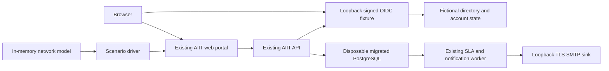

# Synthetic office architecture

The runner uses existing PostgreSQL fixture utilities, Prisma migrations, snapshot validation and import, test issuer, and staging SMTP transport. It reuses ticket, approval, asset, reporting, SLA and audit code. It introduces no database schema or production network operations. Identity, network and mail control live in the runner; application policy continues to resolve current app account, role and SBU.

The repository Compose file offers PostgreSQL 16, Redis, Keycloak and Mailpit, with an enterprise realm import. This milestone keeps those files intact. Docker was absent. Samba/Keycloak federation and Mailpit were therefore not exercised; the fallback uses a signed OIDC simulator and a local TLS SMTP server. The native runtime does not require Redis for these workflows. The workstation had eight logical CPUs, 8 GiB RAM and approximately 12 GiB free disk during the audit. No minimum-capacity benchmark was run. Runtime dependencies are Node 26.8.1, pinned pnpm 9.15.0, PostgreSQL binaries, OpenSSL and installed npm dependencies. Chromium is only required for browser verification.
